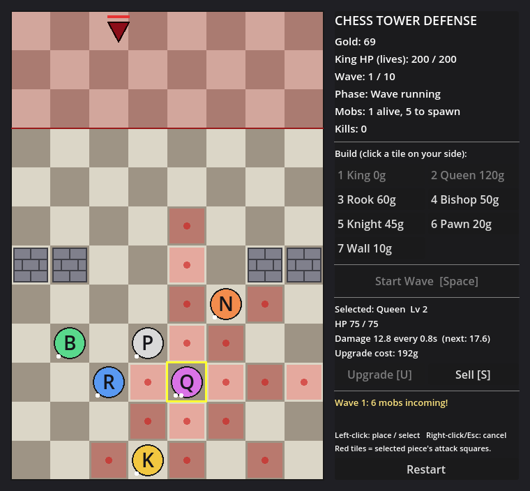

# Chess Tower Defense (Godot 4 PoC)

Minimal tower-defense proof of concept where every tower is a chess piece and can only
attack the squares it could move to in chess. Everything is drawn with `_draw()` vector
primitives (rects, circles, polygons, lines and letter glyphs) - no image assets.



## Requirements / running

* Godot **4.2+** (developed and tested with 4.3-stable, GL Compatibility renderer).
* Run: `godot --path .` from this folder, or open `project.godot` in the editor and press F5.
* Headless import check: `godot --headless --path . --quit`
* Tests: `godot --headless --path . --script res://tests/test_runner.gd` (exit code 0 = all pass)
* Balance autoplay (info only): `godot --headless --path . --script res://tests/autoplay.gd`
* Screenshot (needs a display/xvfb): `godot --path . --script res://tests/screenshot.gd -- out.png`

## Project structure

```
chess-td/
├── project.godot          # project config, main scene, 760x704 window
├── scenes/main.tscn       # Main(Node) -> Game(Node2D, game.gd) + UI(CanvasLayer, ui.gd)
├── scripts/
│   ├── pieces.gd          # piece stats + pure chess attack-pattern functions
│   ├── game.gd            # board state, placement, waves, mob AI (A*), combat, input, _draw()
│   └── ui.gd              # side-panel HUD built in code (stats, build palette, buttons)
├── tests/
│   ├── test_runner.gd     # headless test suite (patterns, placement, waves, combat, UI)
│   ├── autoplay.gd        # greedy bot that plays 10 waves (balance check)
│   └── screenshot.gd      # renders a mid-wave frame to PNG
└── docs/screenshot.png
```

## How to play

1. **Setup phase** - arrange the starting board however you like on your side (rows 4-12; the
   reddish top 3 rows are the enemy spawn zone). The **King is mandatory and unique**; it is free
   and you can remove/re-place it until the first wave starts.
2. Buy towers/walls with gold (start: 200g). Press **Start Wave**.
3. Mobs (red triangles) spawn at the top and walk down toward your King using A* pathfinding.
   They go around your pieces, but if the King is completely walled in they smash through
   the cheapest route instead (no soft-locks). They hit the King when next to it, any piece
   blocking their path, and other pieces adjacent to them as they pass.
4. Towers fire automatically at mobs standing on their attack squares; killing a mob gives gold,
   clearing a wave gives a bonus. You can place, upgrade and sell at any time (also mid-wave).
5. King HP is your "lives": King destroyed = **Game Over**. Survive 10 waves = **Victory**.

### Pieces

| Piece | Cost | Attacks (chess move pattern) |
|---|---|---|
| King (K)   | free | 1 square in all 8 directions |
| Queen (Q)  | 120 | Rook + Bishop lines |
| Rook (R)   | 60  | horizontal / vertical lines |
| Bishop (B) | 50  | diagonal lines |
| Knight (N) | 45  | L-jumps (jumps over pieces) |
| Pawn (P)   | 20  | the two forward-diagonal capture squares (forward = toward the mobs) |
| Wall (#)   | 10  | none - 100 HP blocker |

Sliding pieces (R/B/Q) are blocked by your own pieces/walls like in chess and have a max range
of `2 + level` squares (3 at L1 up to 7 at L5). Upgrades (L1-L5) add +60% base damage per level and
+25% HP (walls +50% HP). Sell refunds 50% of everything spent.

### Controls

| Input | Action |
|---|---|
| Left click empty tile | place the selected build type |
| Left click a piece | select it (its attack squares are highlighted red) |
| Right click / Esc | cancel selection / build type |
| 1-7 | build King, Queen, Rook, Bishop, Knight, Pawn, Wall |
| U / S (Del) | upgrade / sell selected piece |
| Space / Enter | start next wave |

Hovering a tile with a tower type selected previews the piece and its attack squares.

## Limitations (PoC)

* Single mob type; balance is rough (difficulty ramps up: +25% HP and +2 mobs per wave).
* Mobs may overlap on a tile; towers hit one target per shot (the mob closest to the King side).
* No sound, saves, or menus; HUD is built from default Godot controls.
